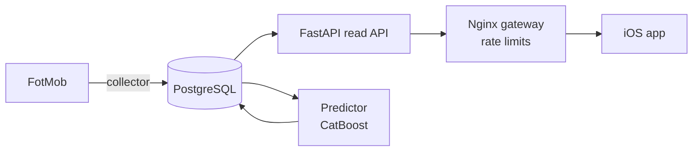

# KickPick

Football scores, tables, lineups and player stats for the major leagues and tournaments, in a native iOS app.


KickPick collects football data from FotMob into its own Postgres database, serves it through a read-only FastAPI
API, and shows it in a SwiftUI app with a dark frosted-glass design. The app never talks to FotMob: it reads only
our API, so screens load fast and stay available when the source is slow.

## Contents

- [Features](#features)
- [Architecture](#architecture)
- [Tech stack](#tech-stack)
- [Getting started](#getting-started)
- [Project structure](#project-structure)
- [Testing](#testing)
- [Documentation](#documentation)
- [Security](#security)
- [Data source](#data-source)

## Features

- **26 competitions**: 20 leagues (the top five, Eredivisie, Liga Portugal, Championship, MLS, Brasileirão and
  others), the Champions League, Europa League and Conference League, the EURO, the World Cup and the Nations League.
- **Live scores** refreshed every 15 seconds, with events, stats and lineups.
- **Match details**: scorers in the score card, form and head-to-head, events, stats, lineups on a pitch, predicted
  lineups before kick-off, and home/draw/away probabilities from the prediction model.
- **Tables** with qualification and relegation zones and a legend, cup brackets, and past seasons
  (the last 11 by default).
- **Clubs and national teams**: results, fixtures, tables, squads, transfers, trophies and stadium facts.
- **Players**: profile facts (height, foot, market value, contract), season stats and career.
- **Search** across competitions, teams and players, and a day-by-day match feed with a calendar.

## Architecture



- **Collector** keeps the database in sync with FotMob: live scores every 15 s, then a backlog of seasons, match
  details, squads and player profiles at about one request per second.
- **API** is read-only, gzipped and cached with ETags. It sits behind an Nginx gateway that applies rate limits.
- **Predictor** (optional) stores immutable pre-match probabilities and checks them against results.
- **iOS app** is SwiftUI, iOS 17+, portrait, dark only.

## Tech stack

| Layer | Technology |
|---|---|
| iOS app | Swift 5, SwiftUI, XcodeGen, XCTest |
| API | Python 3.12+, FastAPI, Uvicorn, SQLAlchemy 2.0, httpx |
| Database | PostgreSQL 17 (JSONB, `pg_trgm` search), Alembic migrations |
| Gateway | Nginx (unprivileged image), per-IP and global rate limits |
| Predictions | CatBoost, scikit-learn, pandas |
| Runtime | Docker Compose with Compose secrets, `uv` for local Python |

## Getting started

### Prerequisites

- Docker with Compose v2
- Python 3.12+ and [uv](https://docs.astral.sh/uv/) for tests and tools
- Xcode 26 and [XcodeGen](https://github.com/yonaskolb/XcodeGen) for the iOS app

### Backend

```bash
python3 backend/tools/init_secrets.py                              # creates .secrets/, never prints passwords
docker compose up -d --build                                       # db → roles → migrations → api → gateway → collector
docker compose exec collector python -m kickpick.collector status  # what is collected and what is left
```

The mobile API answers on `http://localhost:8000`. The progress dashboard and the API docs are on
`http://localhost:8001/dashboard` and `http://localhost:8001/docs`, localhost only. The first sync of past seasons
takes hours; the app is usable as soon as the current seasons are in.

Services, configuration, rate limits and database roles: [backend/README.md](backend/README.md).

### iOS app

```bash
cd ios && xcodegen && open KickPick.xcodeproj
```

The simulator uses `http://localhost:8000`. A real iPhone reaches the API through an HTTPS tunnel set in
`ios/project.yml`. Details: [ios/README.md](ios/README.md).

## Project structure

```text
.
├── backend/
│   ├── kickpick/          # API, collector, FotMob client, models, store, ML module
│   ├── alembic/           # database migrations
│   ├── tests/             # pytest suite and FotMob fixtures
│   └── tools/             # secrets setup, admin password rotation, capacity audit
├── deploy/nginx/          # gateway config: rate limits, trusted proxies
├── ios/
│   ├── KickPick/          # SwiftUI app: API client, design system, features
│   ├── KickPickTests/     # unit tests
│   └── project.yml        # XcodeGen spec (the .xcodeproj is generated)
├── design.md              # design system
└── docker-compose.yml
```

## Testing

```bash
cd backend && uv run pytest              # needs the db service running
cd ios && xcodebuild test -project KickPick.xcodeproj -scheme KickPick \
  -destination 'platform=iOS Simulator,name=iPhone 17'
```

Backend tests use a separate `kickpick_test` database. Each component's README has the details.

## Documentation

| Document | What it covers |
|---|---|
| [design.md](design.md) | Design system: colour, type, glass, components, motion, states |
| [backend/README.md](backend/README.md) | Services, configuration, data collection, rate limits, roles, tests |
| [ios/README.md](ios/README.md) | Building and running the app, real-device setup, tests |
| [backend/kickpick/ml/README.md](backend/kickpick/ml/README.md) | Offline prediction pipeline: data, features, models, evaluation |
| [backend/kickpick/ml/ONLINE.md](backend/kickpick/ml/ONLINE.md) | Prediction service: running it and updating the model |

## Security

The API is a public catalogue with no user accounts. It runs behind Nginx rate limits, each process uses its own
least-privilege database role, passwords live in Compose secrets outside the image, and admin pages are bound to
localhost. Rate limits cap resource use; they do not authenticate the app and are no defence against a volumetric
DDoS. Details: [backend/README.md](backend/README.md#security).

## Data source

Match, team and player data comes from FotMob's public web endpoints. KickPick is not affiliated with FotMob.
